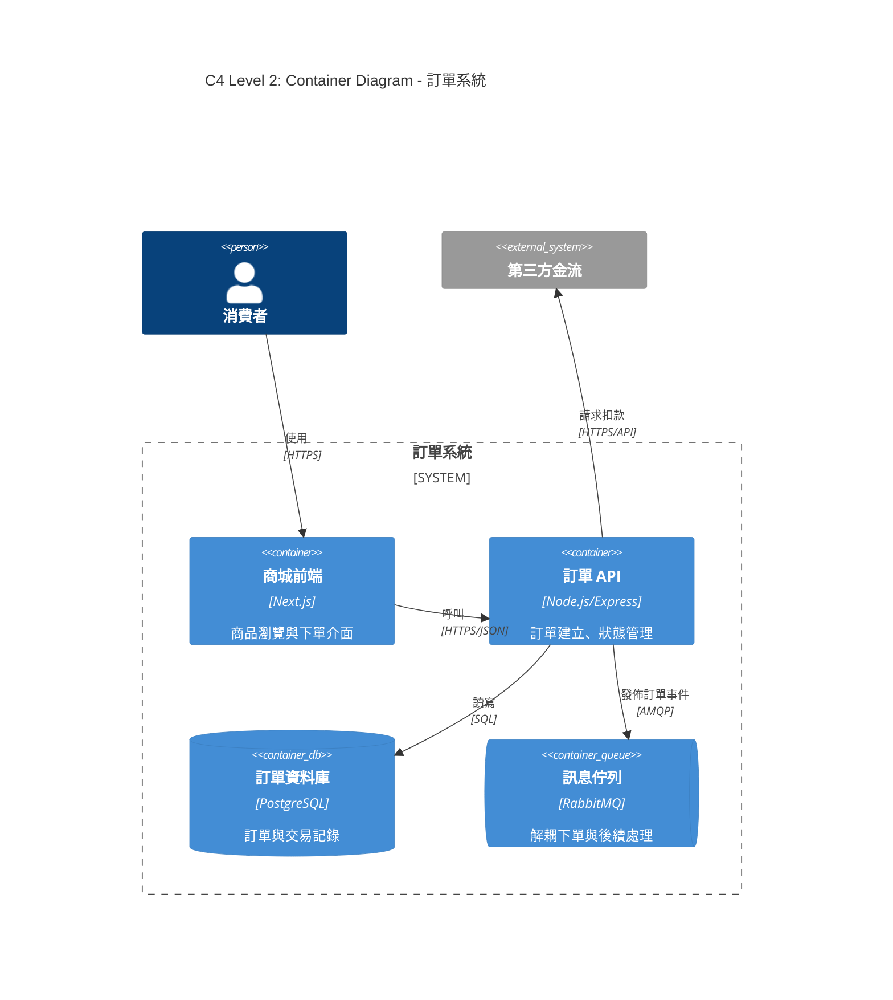
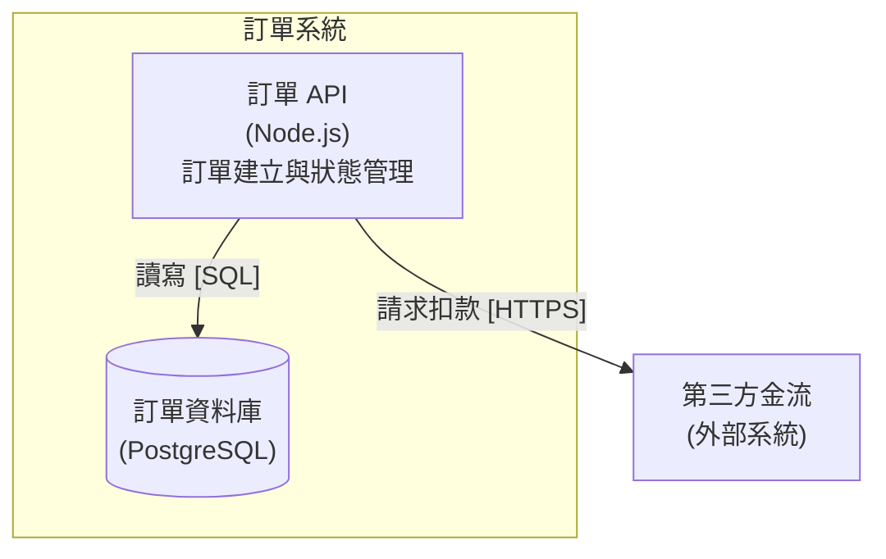

# C4 架構圖

架構圖的價值在建立共識。C4 模型以四個層級讓不同讀者各取所需；每張圖都要做到層級純粹、標籤完整，不需要口頭解釋就能看懂。

## 層級

| 層級 | 回答的問題 | 讀者 | 何時畫 |
|---|---|---|---|
| L1 System Context | 誰在用系統，系統依賴哪些外部系統 | 所有人，含非技術人員 | 永遠先畫，一張即可 |
| L2 Container | 系統由哪些可部署單元組成，如何互動 | 技術團隊 | 技術規劃的核心，必畫 |
| L3 Component | 某個容器內部的主要模組與職責 | 該容器的開發者 | 只畫複雜或高風險的容器 |
| L4 Code | 類別與函式 | 開發者 | 不畫，由 IDE 產生 |

預設交付 L1 與 L2。

## 圖面規則

1. 標題格式為 `C4 Level {N}: {圖名} - {系統名}`。
2. 每個元素寫名稱、技術與一句職責，例如 `訂單 API（Node.js/Express）— 處理訂單建立與狀態查詢`，而不是 `Backend`。
3. 每條線有方向，並以「動詞 + 協定」標示，例如 `提交訂單 [HTTPS/JSON]`。
4. 層級純粹：L1 不出現資料庫與內部服務，L2 不出現類別；混層就拆圖。
5. 元素約 15 到 20 個為上限，超過代表抽象層級錯了，往上收斂或拆成多張。
6. 外部系統以不同樣式標明，系統邊界以框線圈出。
7. 附圖例，說明形狀與顏色的意義。

## 繪製步驟

1. 確認目的與讀者，決定層級。
2. 先以文字列出元素（名稱、技術、職責）與關係（來源、目標、動詞、協定）。
3. 產出 Mermaid 圖與圖例。
4. 依圖面規則逐條自檢。
5. 以 2 到 3 句文字摘要圖的關鍵訊息，確保圖文一致；圖文不一致時擇一為準並修正另一方。

## Mermaid 寫法

優先使用 Mermaid 的 C4 語法；渲染環境不支援時改用 `graph TB`，以命名補足語意。

L1 使用 `C4Context`，元素改為 `Person`、`System`、`System_Ext`。

## 補充視圖

- **Sequence diagram**：關鍵流程的跨容器互動與失敗路徑，一張只畫一個場景。
- **Deployment diagram**：容器如何對應到基礎設施（region、AZ、cluster），討論可用性與災難復原時必畫。

## 常見錯誤

審閱別人的圖時也以此為清單：

- 混層，例如 Context 圖裡出現 Redis。
- 沒有標籤的線、意義不明的雙向箭頭。
- 元素只有名字，沒有技術與職責。
- 一張圖塞進整個平台。
- 圖與文字描述不一致。
